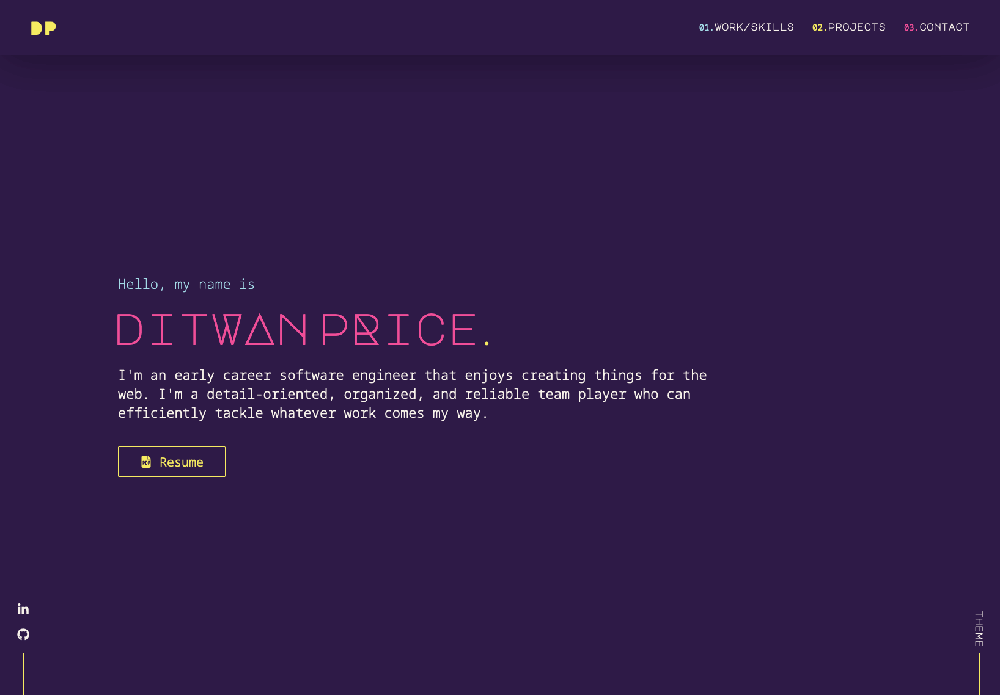

# Description

This is version 2 of my portfolio site. This time around, I redesigned how the site is navigated using react router and framer motion for animating in elements. I also added a personal touch by including the option to change the theming of the site. The themes listed on the site are inspired by the color profiles of custom keycaps for mechanical keyboards.

# Tools Used

- React.js
- React Router
- JavaScript
- Html
- Scss
- Framer Motion (Animation library for React)

# Component Organization and Copy

Each UI component lives in its own folder alongside a `ComponentName.content.js`
module that exports its copy as a plain JavaScript object. For example:

```text
src/components/
  Home/
    Home.jsx
    Home.content.js
  Contact/
    Contact.jsx
    Contact.content.js
```

Edit the content modules to change headings, paragraphs, button text, image
descriptions, and accessible labels. Components retain markup, styling,
animations, and interaction logic. Technical identifiers such as route paths,
theme IDs, and CSS classes stay separate from display copy.

Import themed SVG icons with the `?react` suffix so `vite-plugin-svgr` renders
inline SVGs. This lets the existing SCSS control icon size, fill, and hover
colors. Keep their accessible labels in the component content modules.

# Local Development

Use Node.js 24.11.0 or newer within the 24.x LTS release line (recommended),
or Node.js 22.12.0 or newer within the
22.x LTS release line. The supported versions are declared in `package.json`;
`.nvmrc` selects Node.js 24 when using nvm.

```sh
nvm install
nvm use
npm ci
npm start
```

`npm start` runs the Vite development server. To build and preview the production
site locally:

```sh
npm run build
npm run serve
```

Deploy the generated `dist/` directory. The hosting service must rewrite requests
for `/work-and-skills`, `/projects`, and `/contact` to `index.html` so direct links
and page refreshes work with the browser router.

# Dependency and Behavior Checks

```sh
npm audit
npm run lint
npm run test:smoke
```

`npm run lint` checks application code, configuration, and tests with ESLint's
flat configuration, React JSX checks, and React Hooks rules. Warnings fail the
command. Generated builds and test reports are excluded.

Before running smoke tests for the first time (or after upgrading Playwright),
install the matching Chromium browser:

```sh
npx playwright install chromium
```

On Linux CI hosts, use `npx playwright install --with-deps chromium` to install
the browser's system dependencies too.

`npm run test:smoke` builds the app and starts its own production preview on
`127.0.0.1:4173`. Stop any existing preview on that port first. Playwright shuts
the server down when the run finishes. Tests run in isolated desktop Chromium
and mobile-emulated Chromium sessions; mobile emulation is not a real-device
or cross-browser compatibility test.

The suite covers all four routes and refreshes, all five theme colors and
persistence, theme keyboard navigation, the mobile menu, project images, the
resume PDF, and contact actions. Browser exceptions, console errors, failed
requests, and HTTP errors fail the tests. The mobile-menu-specific test is
intentionally skipped in the desktop project.

Use `npm run test:smoke:ui` for interactive debugging, or
`npx playwright show-report` to open the latest HTML report. Failed tests retain
screenshots and traces; generated reports and results are gitignored.
Run `npm run build` separately when only build validation is needed.

After updating dependencies, check the development server and production preview:

- Navigate between Home, Work/Skills, Projects, and Contact, then refresh each route.
- Confirm page transitions finish and project images load.
- Open the theme picker, try all five themes, and reload to verify persistence.
- At a mobile viewport, open the navigation menu and select a page; confirm it closes.
- Confirm the resume PDF loads and project, social, and email links retain their destinations.
- Using only the keyboard, Tab to the theme or mobile navigation toggle and open
  it with Enter or Space. Focus moves into the open panel; Tab and Shift+Tab
  navigate its controls. Escape closes it and restores focus to the toggle.
  Leaving the disclosure closes it, and closed panels are excluded from keyboard
  navigation and the accessibility tree.
- In the theme picker, Up/Down arrows move focus between themes and wrap at either
  end without changing the selected theme. Enter or Space applies the focused
  theme; Tab and Shift+Tab still work normally.
